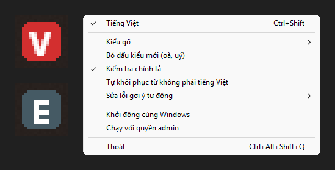

# govn

Bộ gõ tiếng Việt cho Windows viết bằng Rust. Engine được port từ `ukengine` của UniKey (xem `NOTICE`).



govn chỉ xuất Unicode, nên không có và cũng không định thêm macro hay chuyển mã clipboard.

Chưa có: cấu hình theo ứng dụng, cửa sổ cài đặt, trình cài đặt.

## Vì sao viết bằng Rust

Bộ gõ xử lý mọi phím bạn gõ, nên một lỗi bộ nhớ ở đây rất tai hại. Rust loại bỏ loại lỗi này ở phần xử lý tiếng Việt (phần gọi Windows vẫn cần `unsafe`). Engine cho kết quả giống bản C++ gốc trên khoảng 5,9 triệu phím ASCII, và không crash ở những chuỗi phím đã làm bản gốc crash. Chương trình là một file `.exe` khoảng 340 KB, không cần cài runtime.

## Chạy

Nếu đang dùng bộ gõ khác, chuyển nó sang chế độ E trước để tránh gõ bị đôi.

Chạy `govn.exe`: không có cửa sổ, chỉ có icon ở khay hệ thống. Windows 11 có thể để icon trong khu ẩn `^`; kéo ra thanh tác vụ để luôn thấy.

- Icon **V** đỏ: tiếng Việt. Icon **E** xám: English.
- Nhấp trái icon hoặc nhấn Ctrl+Shift: bật/tắt.
- Nhấp phải icon: kiểu gõ, bỏ dấu kiểu mới, kiểm tra chính tả, tự khôi phục, sửa lỗi gợi ý, khởi động cùng Windows, chạy với quyền admin, thoát.
- Ctrl+Alt+Shift+Q: thoát.

Cài đặt lưu ở `%APPDATA%\govn\settings.ini`. "Khởi động cùng Windows" ghi giá trị `govn` vào `HKCU\Software\Microsoft\Windows\CurrentVersion\Run`, không cần quyền admin.

Tham số dòng lệnh ghi đè cài đặt đã lưu:

```
govn [--method telex|vni|simple|simple2] [--modern] [--no-spell-check] [--auto-restore] [--off] [--suggestion-fix auto|always|never] [--config <file>]
```

### Ứng dụng chạy quyền admin

Windows không cho chương trình quyền thường nhận hay gửi phím cho cửa sổ quyền admin, nên ở đó govn quyền thường gõ ra chữ không dấu. Có hai cách:

- Chuột phải `govn.exe` → Run as administrator, dùng cho một lần.
- Menu → "Chạy với quyền admin": hỏi UAC một lần, tạo scheduled task `govn` chạy quyền cao nhất khi đăng nhập và thay cho mục khởi động cùng Windows. Mở `govn.exe` bằng tay lúc này cũng tự chuyển sang task.

Chỉ bật khi `govn.exe` nằm ở thư mục chỉ admin sửa được, như `C:\Program Files\govn\`. Nếu không, phần mềm khác có thể thay file này để lên quyền admin mà không qua UAC.

### Windows Defender

Bộ gõ nào cũng phải dùng hook bàn phím và tự gõ lại phím, giống hành vi của phần mềm độc hại, và file chưa được ký số. Defender từng xóa bản build trong thư mục tạm với nhãn `Trojan:Win32/Bearfoos.A!ml`, và chặn việc tạo task quyền admin trỏ tới file trong thư mục tạm với nhãn `Behavior:Win32/Execution.A!ml`. Cùng thao tác đó với file trong `Program Files` thì không bị báo trên máy phát triển, nhưng kết quả có thể đổi theo từng bản build và từng máy. Muốn phát hành thì cần ký số và gửi file cho Microsoft xem xét báo nhầm.

### Gợi ý tự động

Trình duyệt và Excel hiện gợi ý dưới dạng chữ bôi đen sau con trỏ (`go|ogle.com`), nên phím Backspace chỉ xóa gợi ý và chữ ra sai (`goõ`). Trong các app này, govn gõ đè một ký tự giữ chỗ (U+202F) rồi xóa thêm một lần.

- Tự động (`auto`, mặc định): chỉ bật cho các app trong `SUGGESTION_APPS` ở `app/src/main.rs`.
- Luôn bật / Tắt (`always` / `never`): bật hoặc tắt cho mọi app.

## Build

```
cargo build --release
```

Nếu thư mục dự án nằm ở đường dẫn quá dài, linker báo `LNK1104`: đặt `CARGO_TARGET_DIR` sang một đường dẫn ngắn.

## Test

- `cargo test --workspace`: từ tiếng Việt thật, chuỗi phím ngẫu nhiên không được làm engine panic, đọc/ghi file cài đặt.
- `tools/difftest.py`: so Rust với bản C++ gốc trên cùng chuỗi phím. Lấy `ukengine/` từ `ibus-unikey`, build oracle bằng `tools/oracle/build.bat` (đường dẫn trong file giả định `ibus-unikey/` nằm ngang hàng thư mục `tools` gốc), rồi:
  `ASCII_ONLY=1 python tools/difftest.py <oracle.exe> <trace.exe> 30000 1`
- `cargo run --release -p govn --example e2e -- <govn.exe>`: gõ phím thật vào cửa sổ test riêng. Nó chỉ gõ khi cửa sổ test đang ở foreground. Phần khay kiểm tra từng lệnh menu bằng tác dụng thật khi gõ, dùng file cài đặt và khóa registry tạm.
- `tools/test_chrome.py`: thử trên Chrome thật (hồ sơ tạm, trang local): thanh địa chỉ có gợi ý, `textarea`, `input`, `contenteditable`.
- `tools/test_vscode.py`: thử trên VS Code thật (hồ sơ tạm, không extension), có đối chứng popup gợi ý.
- `tools/test_excel.ps1`: thử trên Excel thật, trong workbook trắng không lưu.
- `tools/test_admin.py`: gõ vào cửa sổ quyền admin thật, với govn quyền thường và quyền admin. Cần bấm UAC.
- `tools/test_admin_menu.py`: bật chế độ admin từ menu với file trong `Program Files`, xong tự dọn. Cần bấm UAC hai lần.

`engine/src/tables.rs` được sinh tự động bằng `tools/gen_tables.py`, không sửa tay.
