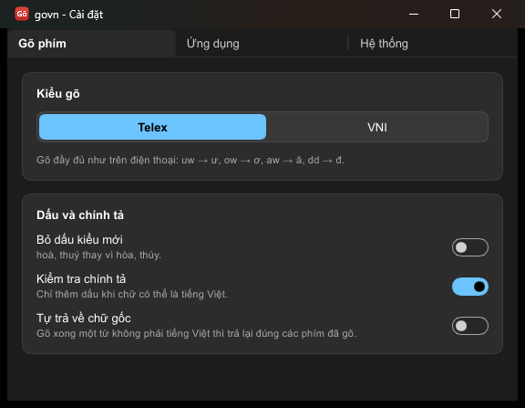
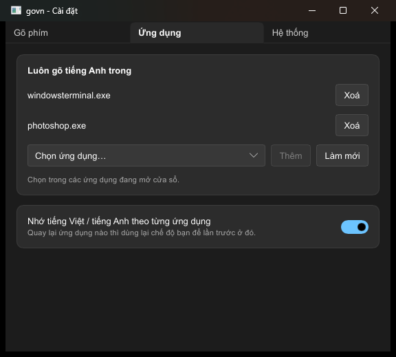
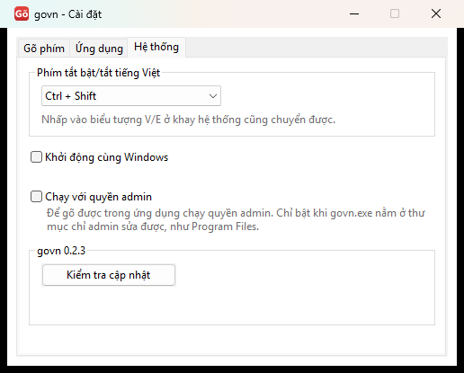

#  govn

Bộ gõ tiếng Việt cho Windows viết bằng Rust. Engine được port từ `ukengine` của UniKey (xem `NOTICE`).



govn chỉ xuất Unicode, nên không có và cũng không định thêm macro hay chuyển mã clipboard.

Chưa có: trình cài đặt. Không định thêm gõ tắt.

## Vì sao viết bằng Rust

- **An toàn hơn:** bộ gõ thấy mọi phím bạn gõ, kể cả mật khẩu. Rust tránh được lỗi bộ nhớ, loại lỗi hay gây crash và lỗ hổng bảo mật. Phần giao tiếp với Windows thì Rust chỉ bảo vệ được một phần.
- **Gõ đúng như bản gốc:** đã so với phần xử lý tiếng Việt của UniKey trên khoảng 5,9 triệu phím thường (không dấu), kết quả giống hệt.
- **Không crash ở những chỗ bản gốc crash:** khi thử, một số chuỗi phím làm bản C++ gốc crash, còn govn thì không.
- **Một file:** chỉ một file `.exe`, không cần cài thêm gì. Phần chạy nền chỉ dùng Win32; cửa sổ cài đặt dùng [Slint](https://slint.dev) và chạy thành tiến trình riêng khi bạn mở, nên phần đọc phím không mang theo nó. File khoảng 9,7 MB, phần lớn là Slint.

## Chạy

Nếu đang dùng bộ gõ khác, chuyển nó sang chế độ E trước để tránh gõ bị đôi.

Chạy `govn.exe`: không có cửa sổ, chỉ có icon ở khay hệ thống. Windows 11 có thể để icon trong khu ẩn `^`; kéo ra thanh tác vụ để luôn thấy.

- Icon **V** đỏ: tiếng Việt. Icon **E** xám: English.
- Nhấp trái icon hoặc nhấn phím tắt (mặc định Ctrl+Shift): bật/tắt.
- Nhấp phải icon: menu có đủ mọi tùy chọn (kiểu gõ, bỏ dấu, chính tả, sửa lỗi gợi ý, khởi động cùng Windows, quyền admin, kiểm tra cập nhật), cùng mục Cài đặt và Thoát. Nhấp đúp icon cũng mở Cài đặt.
- Cửa sổ Cài đặt:
  - **Gõ phím:** Telex hoặc VNI, bỏ dấu kiểu mới, kiểm tra chính tả, tự trả về chữ gốc.
  - **Ứng dụng:** danh sách ứng dụng luôn gõ tiếng Anh, chọn từ các cửa sổ đang mở (ghi tên ứng dụng kèm tên file, như "Visual Studio Code (code.exe)"); nhớ tiếng Việt/tiếng Anh theo từng ứng dụng.
  - **Hệ thống:** phím tắt (Ctrl+Shift, Ctrl+Alt, Alt+Z hoặc không dùng), khởi động cùng Windows, chạy với quyền admin, kiểm tra cập nhật.

  
  

- Ctrl+Alt+Shift+Q: thoát.

Cài đặt lưu ở `%APPDATA%\govn\settings.ini`; trạng thái nhớ theo ứng dụng lưu ở `apps.ini` cùng thư mục. "Khởi động cùng Windows" ghi giá trị `govn` vào `HKCU\Software\Microsoft\Windows\CurrentVersion\Run`, không cần quyền admin.

Tham số dòng lệnh ghi đè cài đặt đã lưu:

```
govn [--method telex|vni] [--modern] [--no-spell-check] [--auto-restore] [--off] [--suggestion-fix auto|always|never] [--config <file>] [--settings]
```

### Ứng dụng chạy quyền admin

Windows không cho chương trình quyền thường nhận hay gửi phím cho cửa sổ quyền admin, nên ở đó govn quyền thường gõ ra chữ không dấu. Có hai cách:

- Chuột phải `govn.exe` → Run as administrator, dùng cho một lần.
- Cài đặt → Hệ thống → "Chạy với quyền admin": hỏi UAC một lần, tạo scheduled task `govn` chạy quyền cao nhất khi đăng nhập và thay cho mục khởi động cùng Windows. Mở `govn.exe` bằng tay lúc này cũng tự chuyển sang task.

Chỉ bật khi `govn.exe` nằm ở thư mục chỉ admin sửa được, như `C:\Program Files\govn\`. Nếu không, phần mềm khác có thể thay file này để lên quyền admin mà không qua UAC.

### Kiểm tra cập nhật

Nút "Kiểm tra cập nhật" trong Cài đặt → Hệ thống hỏi `api.github.com` phiên bản mới nhất. Đây là kết nối mạng duy nhất của govn và chỉ chạy khi bạn bấm. Yêu cầu không chứa gì bạn đã gõ; GitHub chỉ thấy địa chỉ IP và phiên bản govn. govn không tự tải hay tự cài: có bản mới thì nó cho nút mở trang tải về, bạn tự thoát govn và chép đè file.

### Windows Defender

Bộ gõ nào cũng phải dùng hook bàn phím và tự gõ lại phím, giống hành vi của phần mềm độc hại, và file chưa được ký số. Defender từng xóa bản build trong thư mục tạm với nhãn `Trojan:Win32/Bearfoos.A!ml`, và chặn việc tạo task quyền admin trỏ tới file trong thư mục tạm với nhãn `Behavior:Win32/Execution.A!ml`. Cùng thao tác đó với file trong `Program Files` thì không bị báo trên máy phát triển, nhưng kết quả có thể đổi theo từng bản build và từng máy. Muốn phát hành thì cần ký số và gửi file cho Microsoft xem xét báo nhầm.

### Gợi ý tự động

Trình duyệt và Excel hiện gợi ý dưới dạng chữ bôi đen sau con trỏ (`go|ogle.com`), nên phím Backspace chỉ xóa gợi ý và chữ ra sai (`goõ`). Trong các app này, govn gõ đè một ký tự giữ chỗ (U+202F) rồi xóa thêm một lần.

- Tự động (`auto`, mặc định): chỉ bật cho các app trong `SUGGESTION_APPS` ở `app/src/main.rs`.
- Luôn bật / Tắt (`always` / `never`): bật hoặc tắt cho mọi app.

## Build

```
cargo build --release
```

Lần build đầu mất khoảng 10-15 phút vì phải biên dịch Slint; các lần sau nhanh hơn nhiều.

Khi phát hành, `python tools/third_party.py THIRD-PARTY-LICENSES.txt` gom giấy phép của mọi thư viện nằm trong `govn.exe` để đóng gói cùng.

Nếu thư mục dự án nằm ở đường dẫn quá dài, linker báo `LNK1104`: đặt `CARGO_TARGET_DIR` sang một đường dẫn ngắn.

## Test

- `cargo test --workspace`: từ tiếng Việt thật, chuỗi phím ngẫu nhiên không được làm engine panic, đọc/ghi file cài đặt.
- `tools/difftest.py`: so Rust với bản C++ gốc trên cùng chuỗi phím. Lấy `ukengine/` từ `ibus-unikey`, build oracle bằng `tools/oracle/build.bat` (đường dẫn trong file giả định `ibus-unikey/` nằm ngang hàng thư mục `tools` gốc), rồi:
  `ASCII_ONLY=1 python tools/difftest.py <oracle.exe> <trace.exe> 30000 1`
- `cargo test -p govn real_github -- --ignored`: gọi GitHub thật. `tools/test_update.py <govn.exe> <chữ cần thấy>`: bấm lệnh kiểm tra cập nhật của khay và đọc hộp thoại kết quả.
- `cargo run --release -p govn --example e2e -- <govn.exe>`: gõ phím thật vào cửa sổ test riêng. Nó chỉ gõ khi cửa sổ test đang ở foreground. Phần khay kiểm tra từng lệnh menu bằng tác dụng thật khi gõ, dùng file cài đặt và khóa registry tạm.
- `tools/test_chrome.py`: thử trên Chrome thật (hồ sơ tạm, trang local): thanh địa chỉ có gợi ý, `textarea`, `input`, `contenteditable`.
- `tools/test_vscode.py`: thử trên VS Code thật (hồ sơ tạm, không extension), có đối chứng popup gợi ý.
- `tools/test_excel.ps1`: thử trên Excel thật, trong workbook trắng không lưu.
- `tools/test_admin.py`: gõ vào cửa sổ quyền admin thật, với govn quyền thường và quyền admin. Cần bấm UAC.
- `tools/test_admin_menu.py`: bật chế độ admin từ menu với file trong `Program Files`, xong tự dọn. Cần bấm UAC hai lần.

`engine/src/tables.rs` được sinh tự động bằng `tools/gen_tables.py`, không sửa tay.

## Giấy phép

Mã của govn theo GPL-3.0-or-later (`LICENSE`). Engine port từ `ukengine` của UniKey, tác giả Phạm Kim Long (xem `NOTICE`). Slint chỉ dùng được theo GPL-3.0, nên file `govn.exe` build ra phát hành theo GPL-3.0.
